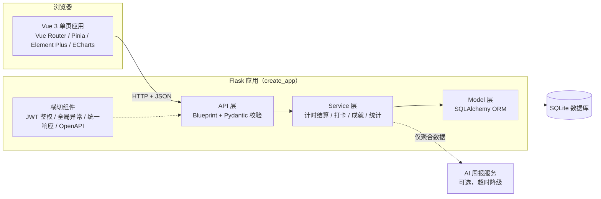
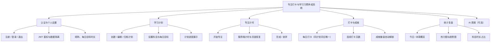
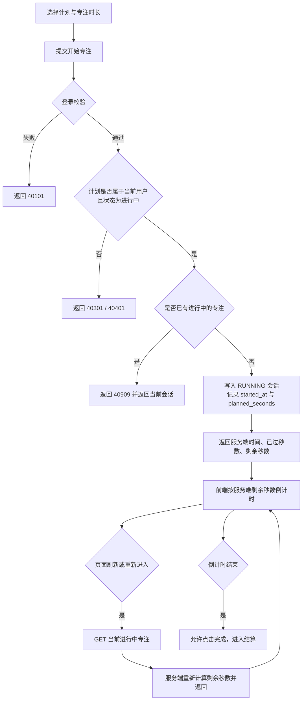
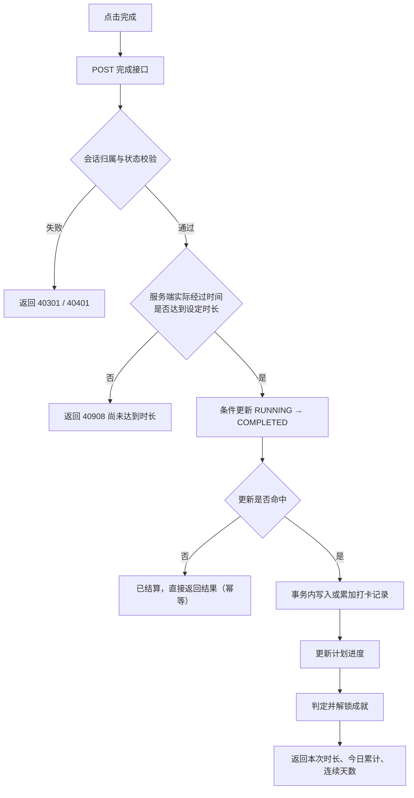
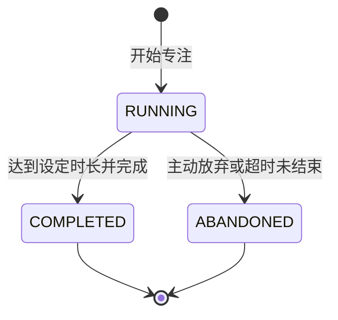
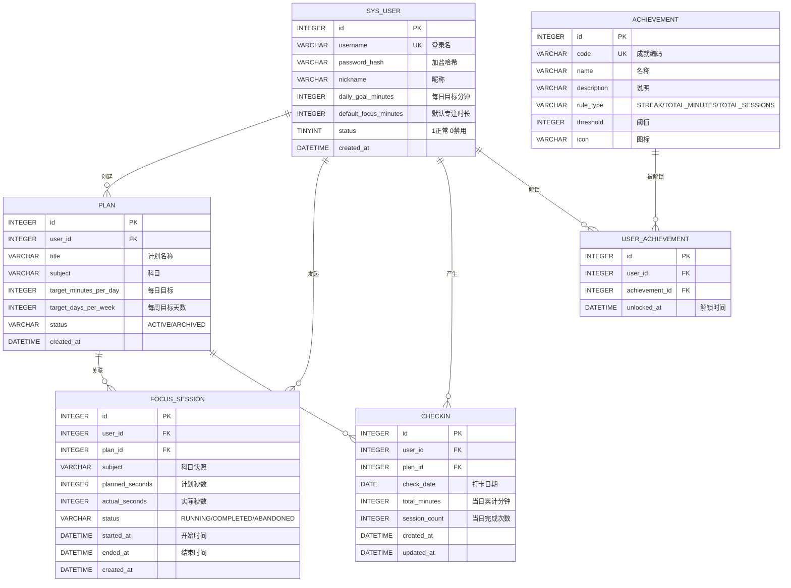

# 课程设计选题设计文档

| 项目 | 内容 |
| --- | --- |
| 设计题目 | 专注打卡与学习习惯养成系统（FocusTrack） |
| 选题方向 | 方向五：学习效率与习惯养成类 |

## 一、课题说明

### 1.1 选题背景

"开始学习"这件事本身往往比学习内容更难。很多同学坐到书桌前，先刷十分钟手机，再整理一下桌面，一上午就过去了；也有人用番茄钟 App 强迫自己专注，但记录散落在手机里，过几天就不再打开。到了期末复盘，既说不清这个月学了多少小时，也看不出时间花在了哪一科上。

现有的学习类 App 大致分两类：一类是纯计时工具，功能单一，换设备后数据不同步；另一类加入了好友排行、自习室、打卡社区，功能越来越重，反而让人分心。课程设计需要的不是一个大而全的产品，而是一个能把"设定目标—专注计时—打卡记录—统计复盘"这条链路走通的小系统。因此我选择方向五，做一套以个人使用为主、数据留在自己数据库里的专注打卡系统。

### 1.2 目标用户与使用场景

系统只设置一种登录角色"学习者"，不设管理员后台。访客可以打开登录页和系统说明页，但看不到任何学习数据；所有计划、专注记录、统计结果都按 `user_id` 隔离，登录用户只能访问自己的数据。这一边界会在后端每个查询和修改接口中校验，不能只靠前端隐藏入口。

| 用户 | 说明 | 主要诉求 |
| --- | --- | --- |
| 学习者 | 备考考研、四六级、期末考试的在校学生，或需要自我管理的自学者 | 设定每日目标、开始专注计时、查看连续打卡与统计、获得阶段反馈 |
| 访客 | 未登录访问者 | 了解系统功能，注册或登录后才能使用 |

典型场景：

1. **早晨开始第一段专注**：学生进入"今日"页面，看到今日目标 120 分钟、当前连续打卡 6 天。选择"考研数学"计划，点击"开始专注"，默认 25 分钟。页面进入全屏倒计时，中途刷新或误关页面，重新打开后仍能恢复到正确的剩余时间。
2. **完成一段专注**：倒计时结束后点击"完成"，系统根据服务端记录的实际时长写入本次专注，更新当天打卡记录和计划进度，并提示"今日已专注 75 分钟，距离目标还差 45 分钟"。
3. **中途放弃**：开始 8 分钟后被事情打断，选择"放弃本次专注"。本次记录标记为放弃，不计入打卡和统计，但保留在历史记录中，便于以后回看。
4. **周末复盘**：学生在统计页查看近 12 周热力图、近 30 天专注趋势和各科目时长占比；点击"生成本周周报"，系统根据本周数据给出一段总结和三条建议。AI 不可用时，页面展示按模板拼接的统计摘要，不影响其他功能。

### 1.3 拟解决的问题

1. **启动困难、缺少节奏**：用固定时长的专注单元降低开始门槛，配合今日目标进度，让"今天还差多少"变得可见。
2. **记录分散、容易中断**：专注记录、打卡、计划进度都持久化在数据库中；刷新页面或更换浏览器后，数据仍然存在，不会因为关掉页面而丢失计时。
3. **重复打卡、数据失真**：同一计划同一天只允许一条打卡记录，重复完成只累加时长，不重复计天数；同一用户同一时间只允许一个进行中的专注，避免刷数据。
4. **缺少可复盘的数据**：提供日、周、月维度的时长趋势、科目分布和连续天数，把"感觉学了很久"变成具体数字。
5. **坚持缺少反馈**：通过连续打卡天数和成就徽章给出阶段性反馈，但不做排行榜和社交关系，避免比较带来的压力。

### 1.4 特色与创新点

1. **服务端权威计时，刷新可恢复**。开始专注时由后端记录 `started_at` 和计划时长，前端只负责展示倒计时；剩余时间以服务端时间为准计算，不信任浏览器本地时钟。页面刷新后调用"当前进行中专注"接口即可恢复，不会出现"刷新一下就重新计时"或"改系统时间就能提前完成"的问题。
2. **不做暂停，改用放弃机制**。暂停会让服务端计时和真实专注时间产生歧义，也会增加状态复杂度。本系统只允许"完成"或"放弃"：完成按服务端实际经过时间结算，放弃保留记录但不计入统计。规则简单，边界清楚。
3. **打卡幂等与唯一约束**。`checkin` 表在 `(user_id, plan_id, check_date)` 上建立唯一索引；同一天同一计划的第二段专注通过 upsert 累加时长和次数，打卡天数只按日期去重统计。重复提交"完成"接口也做幂等处理，不会产生两条记录。
4. **数据库层限制并发会话**。利用 SQLite 的部分唯一索引，在 `user_id` 上只对 `status = 'RUNNING'` 的记录建唯一约束，从数据库层面保证一个用户最多只有一个进行中的专注，比在应用层"先查再插"可靠。
5. **统计与 AI 周报结合**。热力图、趋势图和科目占比用于自己复盘；AI 周报只读取聚合后的统计数据生成文字建议，超时或失败时自动退回模板摘要，AI 不参与计时、打卡和成就判定。
6. **轻量可复现**。数据库使用 SQLite，附建表脚本和近 60 天的演示数据，教师按 README 即可在本地运行并看到完整的热力图效果。

### 1.5 范围边界

为保证课程周期内能做完、能演示，本项目明确不做以下内容：好友关系与排行榜、自习室组队、课程表导入、消息推送、移动端原生 App、真实支付。系统聚焦"一个人、一个目标、一段专注、一份记录"，核心功能控制在 5 个以内。

## 二、项目框架

### 2.1 技术选型及理由

| 层次 | 技术 | 版本 | 选型理由 |
| --- | --- | --- | --- |
| 前端框架 | Vue 3 + TypeScript | 3.5 / 5.x | 组合式 API 便于把计时、统计等逻辑拆成组合式函数；TypeScript 约束接口字段，减少联调错误 |
| 构建工具 | Vite | 6.x | 热更新快，代理配置简单，适合频繁调整页面 |
| 路由与状态 | Vue Router / Pinia | 4.x / 3.x | 路由守卫控制登录访问；Pinia 保存当前用户、进行中的专注和计时状态 |
| UI 组件库 | Element Plus | 2.9.x | 表单、对话框、日期选择、进度环等组件齐全，中文文档完善 |
| 图表 | ECharts | 5.6.x | 支持日历热力图、折线图、饼图，统计页面可直接使用 |
| HTTP 客户端 | Axios | 1.x | 拦截器统一附加 Token、处理 401 和错误提示 |
| 后端框架 | Flask | 3.1.x | 轻量、迭代快；按应用工厂和 Blueprint 组织，满足课程工程化要求 |
| ORM 与迁移 | Flask-SQLAlchemy / Flask-Migrate | 3.1 / 4.x | ORM 参数化查询防注入；迁移脚本管理表结构 |
| 认证 | Flask-JWT-Extended | 4.7.x | 访问令牌 + 刷新令牌，装饰器完成接口鉴权 |
| 参数校验 | Pydantic | 2.x | 请求体与查询参数校验，统一错误信息 |
| 接口文档 | flask-smorest | 0.46.x | 生成 OpenAPI 文档并提供 Swagger UI |
| 跨域 | Flask-CORS | 5.x | 只允许前端开发地址访问 |
| 数据库 | SQLite | 3.45+ | 零配置、单文件，教师环境易复现；支持部分唯一索引，正好用于限制进行中的专注 |
| 测试 | pytest | 8.x | 接口测试、计时结算与重复提交测试 |
| 代码规范 | ESLint + Prettier / Ruff | — | 前后端统一代码风格 |

后端选择 Flask 而不是 Spring Boot，主要考虑三点：单人开发时 Python 的迭代成本更低；系统需要调用大模型生成周报，Python SDK 更直接；Flask 同样可以通过 `create_app()` 应用工厂、Blueprint 分层和 Pydantic 校验达到课程要求的工程化程度。数据库选择 SQLite，是因为本系统是单用户、低并发的演示型应用，SQLite 没有独立服务进程，初始化只需执行一个脚本；同时它支持部分唯一索引，能够直接在数据库层表达"一个用户只能有一个进行中的专注"这条规则。如果后续需要部署到多人环境，修改连接串即可迁移到 MySQL 8。

### 2.2 总体架构

系统采用前后端分离架构。前端是独立的 Vue 单页应用，后端只返回 JSON，不使用 Jinja2 渲染任何业务页面。浏览器通过 HTTP + JSON 调用后端接口，登录后携带 JWT。



分层职责：

- **API 层**：接收请求、校验参数、调用 service、组装统一响应，不写业务规则。
- **Service 层**：专注开始/完成/放弃、计时结算、打卡幂等、连续天数、成就判定、统计聚合。
- **Model 层**：SQLAlchemy 模型与数据库约束，包括唯一索引、部分唯一索引和外键。
- **横切组件**：JWT 鉴权、资源归属校验、全局异常处理、统一响应结构、Swagger 文档。

前端只负责展示和交互，所有规则以后端为准。例如倒计时结束只代表可以点击"完成"，真正是否满足时长、是否写入打卡，由后端根据 `started_at` 计算后决定。

### 2.3 前端工程结构

```text
frontend/
├── src/
│   ├── api/                 # Axios 实例与接口定义
│   │   ├── request.ts       # 附加 Token、统一错误提示、401 跳转
│   │   ├── auth.ts
│   │   ├── plan.ts
│   │   ├── focus.ts
│   │   ├── stats.ts
│   │   └── achievement.ts
│   ├── components/          # 计时圆环、计划卡片、空数据提示、热力图容器
│   ├── composables/         # useCountdown、useHeatmap
│   ├── layouts/             # 登录后的主布局
│   ├── router/              # 路由表与登录守卫
│   ├── stores/              # Pinia：用户信息、进行中的专注
│   ├── views/
│   │   ├── auth/            # 登录、注册
│   │   ├── dashboard/       # 今日概览
│   │   ├── focus/           # 专注计时页
│   │   ├── plan/            # 计划管理
│   │   ├── stats/           # 统计与周报
│   │   ├── achievement/     # 成就墙
│   │   └── profile/         # 个人资料与密码
│   ├── utils/               # 时间格式化、时长换算
│   ├── App.vue
│   └── main.ts
├── .env.development
├── package.json
├── tsconfig.json
└── vite.config.ts
```

### 2.4 后端工程结构

```text
backend/
├── app/
│   ├── __init__.py          # create_app()：注册扩展、蓝图、异常处理
│   ├── config.py            # 开发/测试/生产配置
│   ├── extensions.py        # db、migrate、jwt、cors、api 实例
│   ├── models/              # user.py、plan.py、focus_session.py、checkin.py、achievement.py
│   ├── schemas/             # Pydantic / Marshmallow 请求与响应模型
│   ├── api/                 # auth.py、plans.py、focus.py、stats.py、achievements.py、ai.py
│   ├── services/            # focus_service.py、checkin_service.py、achievement_service.py、stats_service.py
│   ├── utils/               # 时间处理、统一响应、错误码
│   ├── errors.py            # 全局异常与业务异常
│   └── seed.py              # 演示账号与近 60 天记录
├── migrations/              # Flask-Migrate 迁移脚本
├── tests/                   # pytest 接口与幂等测试
├── .env.example
├── requirements.txt
└── run.py
```

### 2.5 开发与运行环境

| 项目 | 要求 |
| --- | --- |
| 操作系统 | Windows 11 / macOS 14（开发），Linux（可选部署） |
| 前端运行环境 | Node.js 20 LTS，npm 10 |
| 后端运行环境 | Python 3.11 及以上，venv 虚拟环境 |
| 数据库 | SQLite 3（随 Python 内置） |
| 开发工具 | Trae / VS Code、Git 2.40+、Apifox 或 Postman |
| 浏览器 | Chrome / Edge 最新版，适配 1366×768 及以上，窄屏做基础响应式 |

启动步骤（README 中提供完整命令）：

1. 后端：进入 `backend`，创建虚拟环境，`pip install -r requirements.txt`，复制 `.env.example` 为 `.env`，执行 `flask db upgrade` 和 `python -m app.seed`，运行 `python run.py`，默认监听 5000 端口。
2. 前端：进入 `frontend`，`npm install`，`npm run dev`，默认监听 5173 端口，通过 Vite 代理访问后端。
3. 接口文档：后端启动后访问 `/api/docs`。

## 三、功能模块设计

### 3.1 模块划分



### 3.2 功能清单

| 编号 | 功能 | 说明 | 优先级 |
| --- | --- | --- | --- |
| F01 | 注册与登录 | 用户名 + 密码注册，密码加盐哈希；登录签发访问令牌与刷新令牌 | 高 |
| F02 | 数据隔离 | 所有计划、专注、打卡、统计接口按当前用户过滤，资源归属在后端校验 | 高 |
| F03 | 个人设置 | 修改昵称、每日目标时长、默认专注时长 | 中 |
| F04 | 计划管理 | 新建、编辑、归档学习计划，设置科目、每日目标时长和每周目标天数 | 高 |
| F05 | 开始专注 | 选择计划与时长，创建进行中的专注会话 | 高 |
| F06 | 计时恢复 | 刷新或重新进入页面时，按服务端时间恢复剩余秒数 | 高 |
| F07 | 完成专注 | 服务端校验实际经过时间后结算，写入专注记录 | 高 |
| F08 | 放弃专注 | 标记本次会话为放弃，不计入打卡与统计，保留历史 | 高 |
| F09 | 每日打卡 | 完成专注后按"用户 + 计划 + 日期"唯一写入或累加，不重复计天数 | 高 |
| F10 | 连续天数 | 根据打卡日期计算当前连续天数和历史最长连续天数 | 中 |
| F11 | 专注历史 | 按日期、计划、状态分页查询专注记录 | 中 |
| F12 | 今日概览 | 展示今日专注时长、目标完成率、连续天数、最近记录 | 高 |
| F13 | 统计图表 | 近 12 周热力图、近 30 天趋势、科目时长占比 | 中 |
| F14 | 成就徽章 | 连续 7 天、累计 10 小时、完成 100 次专注等，自动解锁 | 中 |
| F15 | AI 周报 | 根据本周聚合数据生成总结与建议，超时降级为模板摘要 | 低（特色） |

### 3.3 核心业务流程

#### 3.3.1 开始专注与页面恢复



计时设计说明：

1. 前端倒计时不使用 `Date.now()` 与本地的开始时间相减，而是根据接口返回的 `remaining_seconds` 在本地递减，并每隔 30 秒调用一次当前会话接口做校时，避免浏览器休眠或系统时间被修改导致偏差。
2. 刷新页面后，前端不自行恢复，而是调用 `GET /api/focus-sessions/active`，由后端根据 `started_at` 重新计算剩余秒数。
3. 如果会话处于 RUNNING 状态超过 6 小时，后端在查询时惰性标记为 ABANDONED，防止用户忘记结束导致"永远有一个进行中的专注"。

#### 3.3.2 完成专注与打卡



打卡幂等的具体做法：

- `checkin` 表唯一索引 `uk_user_plan_date(user_id, plan_id, check_date)`。
- 完成专注时先按唯一键查询当天记录：存在则 `total_minutes += 本次分钟数`、`session_count += 1`；不存在则插入。整个过程在同一个事务中完成。
- 即使客户端重复提交"完成"，第二次条件更新 `WHERE status = 'RUNNING'` 不会命中，接口直接返回第一次的结算结果，不会产生第二条打卡。
- "打卡天数"按 `COUNT(DISTINCT check_date)` 统计，同一天完成多次专注只算一天，符合"不可重复打卡"的要求。

#### 3.3.3 专注会话状态流转



| 状态 | 含义 | 是否计入统计 |
| --- | --- | --- |
| RUNNING | 进行中，已记录开始时间 | 否 |
| COMPLETED | 已完成，实际时长达到设定值 | 是 |
| ABANDONED | 已放弃或超过 6 小时未结束 | 否，仅保留在历史记录 |

### 3.4 主要用例说明

| 用例编号 | 用例名称 | 参与者 | 简述 |
| --- | --- | --- | --- |
| UC-01 | 注册与登录 | 学习者 | 注册账号并登录，获取访问令牌 |
| UC-02 | 管理学习计划 | 学习者 | 新建、编辑、归档计划，设置科目与目标 |
| UC-03 | 开始专注 | 学习者 | 选择计划与时长，创建进行中的会话 |
| UC-04 | 完成专注并打卡 | 学习者 | 达到时长后结算，写入或累加当天打卡 |
| UC-05 | 放弃专注 | 学习者 | 中途放弃，记录保留但不计入统计 |
| UC-06 | 查看统计 | 学习者 | 查看今日概览、热力图、趋势和科目占比 |
| UC-07 | 查看成就 | 学习者 | 查看已解锁和未解锁的成就 |
| UC-08 | 生成 AI 周报 | 学习者 | 根据本周数据生成总结和建议，失败时显示模板摘要 |

**UC-03 开始专注**

- 参与者：学习者
- 前置条件：已登录；至少有一个进行中的计划；当前没有进行中的专注。
- 主流程：
  1. 学习者选择计划，设置本次专注时长（默认 25 分钟，范围 5—120 分钟）；
  2. 前端提交开始请求；
  3. 后端校验登录状态、计划归属、计划状态和是否已有进行中的会话；
  4. 后端写入 RUNNING 会话，记录开始时间与计划秒数；
  5. 返回服务端时间、剩余秒数，前端进入计时页。
- 异常流程：计划不存在返回 40401；计划不属于当前用户返回 40301；已有进行中的专注返回 40909，并返回该会话信息，前端直接恢复到计时页。
- 后置条件：存在一条 RUNNING 会话；数据库部分唯一索引保证该用户不会出现第二条进行中记录。

**UC-04 完成专注并打卡**

- 参与者：学习者
- 前置条件：存在属于当前用户的 RUNNING 会话；服务端时间已达到设定时长。
- 主流程：
  1. 学习者点击完成；
  2. 后端校验归属、状态和实际经过时间；
  3. 后端将状态更新为 COMPLETED，记录结束时间与实际秒数；
  4. 后端按用户、计划、日期写入或累加打卡；
  5. 后端判定成就是否解锁；
  6. 返回本次时长、今日累计时长、连续天数和解锁提示。
- 异常流程：未达到设定时长返回 40908；会话不属于本人返回 40301；重复提交时返回第一次的结算结果。
- 后置条件：专注记录为 COMPLETED；当天打卡记录存在且已累加；相关成就可能被解锁。

**UC-06 查看统计**

- 参与者：学习者
- 前置条件：已登录。
- 主流程：学习者进入统计页，选择时间范围；后端按当前用户聚合打卡与专注数据，返回每日分钟数、科目分布、连续天数；前端用 ECharts 绘制热力图、折线图和饼图。
- 异常流程：时间范围不合法返回 40001；无数据时返回空数组，前端展示空状态提示。
- 后置条件：无数据变更。

## 四、数据库选型与初步设计

### 4.1 选型说明

选用 **SQLite 3**，理由如下：

1. 系统面向个人使用，单机演示的数据量和并发量都很小，SQLite 足够。
2. 无需安装数据库服务，一个文件即数据库，教师按 README 执行脚本即可复现。
3. SQLite 支持唯一索引、部分唯一索引、外键和事务，本项目需要的约束都能直接表达。
4. 通过 SQLAlchemy 访问数据库，后续如需切换 MySQL 8，主要修改连接串和处理少量方言差异。

SQLite 默认不强制外键，因此会在应用启动时执行 `PRAGMA foreign_keys = ON`，并在建表脚本中显式声明外键。

### 4.2 E-R 图



### 4.3 核心表结构

**表 1 专注会话表 focus_session**

| 字段 | 类型 | 约束 | 说明 |
| --- | --- | --- | --- |
| id | INTEGER | 主键，自增 | 会话 ID |
| user_id | INTEGER | 非空，外键 → sys_user.id | 所属用户 |
| plan_id | INTEGER | 非空，外键 → plan.id | 所属计划 |
| subject | VARCHAR(32) | 非空 | 科目快照，避免计划改名后历史记录变化 |
| planned_seconds | INTEGER | 非空，检查 300—7200 | 计划专注秒数 |
| actual_seconds | INTEGER | 非空，默认 0，检查 ≥ 0 | 实际专注秒数 |
| status | VARCHAR(16) | 非空，默认 RUNNING，检查约束 | RUNNING / COMPLETED / ABANDONED |
| started_at | DATETIME | 非空 | 服务端开始时间 |
| ended_at | DATETIME | 可空 | 结束时间 |
| created_at | DATETIME | 默认当前时间 | 创建时间 |

索引：`idx_focus_user_started(user_id, started_at)` 用于历史记录查询；部分唯一索引 `uk_user_running ON focus_session(user_id) WHERE status = 'RUNNING'` 用于限制同一用户只能有一个进行中的专注。

**表 2 打卡表 checkin**

| 字段 | 类型 | 约束 | 说明 |
| --- | --- | --- | --- |
| id | INTEGER | 主键，自增 | 打卡记录 ID |
| user_id | INTEGER | 非空，外键 → sys_user.id | 用户 |
| plan_id | INTEGER | 非空，外键 → plan.id | 计划 |
| check_date | DATE | 非空 | 打卡日期（Asia/Shanghai） |
| total_minutes | INTEGER | 非空，默认 0，检查 ≥ 0 | 当日累计专注分钟 |
| session_count | INTEGER | 非空，默认 1，检查 ≥ 1 | 当日完成次数 |
| created_at | DATETIME | 默认当前时间 | 首次打卡时间 |
| updated_at | DATETIME | 默认当前时间 | 最近更新时间 |

唯一索引：`uk_user_plan_date(user_id, plan_id, check_date)`，保证同一计划同一天只有一条打卡记录。统计打卡天数时按 `check_date` 去重，同一天多段专注不重复计天数。

**表 3 学习计划表 plan**

| 字段 | 类型 | 约束 | 说明 |
| --- | --- | --- | --- |
| id | INTEGER | 主键，自增 | 计划 ID |
| user_id | INTEGER | 非空，外键 → sys_user.id | 所属用户 |
| title | VARCHAR(50) | 非空 | 计划名称 |
| subject | VARCHAR(32) | 非空 | 科目，用于统计分类 |
| target_minutes_per_day | INTEGER | 非空，默认 60，检查 1—720 | 每日目标时长 |
| target_days_per_week | INTEGER | 非空，默认 5，检查 1—7 | 每周目标天数 |
| status | VARCHAR(16) | 非空，默认 ACTIVE | ACTIVE / ARCHIVED |
| created_at | DATETIME | 默认当前时间 | 创建时间 |

唯一约束：`uk_user_plan_title(user_id, title)`，避免同一用户创建重名计划。

**表 4 用户表 sys_user**

| 字段 | 类型 | 约束 | 说明 |
| --- | --- | --- | --- |
| id | INTEGER | 主键，自增 | 用户 ID |
| username | VARCHAR(32) | 非空，唯一 | 登录名 |
| password_hash | VARCHAR(128) | 非空 | Werkzeug 加盐哈希 |
| nickname | VARCHAR(32) | 非空 | 昵称 |
| daily_goal_minutes | INTEGER | 非空，默认 120，检查 1—1440 | 每日总目标 |
| default_focus_minutes | INTEGER | 非空，默认 25，检查 5—120 | 默认专注时长 |
| status | TINYINT | 非空，默认 1 | 1 正常，0 禁用 |
| created_at | DATETIME | 默认当前时间 | 注册时间 |

**表 5、表 6 成就相关表**

`achievement` 保存成就定义，包括编码、名称、说明、规则类型（连续天数、累计分钟、累计次数）、阈值和图标；`user_achievement` 保存用户解锁记录，唯一约束 `uk_user_achievement(user_id, achievement_id)` 保证同一成就只解锁一次。成就定义由种子脚本写入，不在前端硬编码。

### 4.4 关键约束与数据一致性

1. **一个用户一个进行中专注**：依靠部分唯一索引 `uk_user_running`，插入第二条 RUNNING 记录会触发唯一约束错误，业务层捕获后返回 40909。
2. **打卡不可重复**：依靠 `uk_user_plan_date`，完成专注时用"查询 + 更新或插入"的 upsert 逻辑，整个过程放在一个事务中。
3. **完成接口幂等**：更新语句带有 `WHERE status = 'RUNNING'` 条件，重复请求不会重复累加打卡。
4. **外键与级联**：`focus_session.plan_id`、`checkin.plan_id` 使用 `ON DELETE CASCADE` 会导致删除计划时丢失历史，因此计划只允许归档，不提供物理删除；用户删除功能不在本期范围。
5. **时间统一**：所有日期按 `Asia/Shanghai` 计算，`check_date` 由服务端生成，不接收前端传入的日期，避免通过改本地时间刷打卡。
6. **初始化脚本**：`sql/schema.sql` 建表并创建索引，`sql/seed.sql` 写入 2 个演示账号、3 个计划、成就定义和近 60 天打卡数据，便于教师直接看到完整热力图。

## 五、接口初步设计

### 5.1 设计规范

- 遵循 RESTful 风格，资源使用名词复数，使用 GET / POST / PUT / DELETE 表达操作。
- 统一响应结构：`{"code": 0, "message": "ok", "data": ...}`，`code` 为 0 表示成功。
- 分页参数统一为 `page`、`page_size`，分页响应为 `{"items": [], "page": 1, "page_size": 10, "total": 0}`。
- 除注册、登录外，接口均需在请求头携带 `Authorization: Bearer <token>`。
- 路径统一以 `/api` 开头，Swagger 文档地址为 `/api/docs`。
- 所有返回数据默认只包含当前用户的数据，不接受前端传入 `user_id`。

### 5.2 核心接口清单

| 方法 | 路径 | 说明 | 权限 |
| --- | --- | --- | --- |
| POST | /api/auth/register | 注册 | 公开 |
| POST | /api/auth/login | 登录，返回访问令牌与刷新令牌 | 公开 |
| POST | /api/auth/refresh | 刷新访问令牌 | 登录 |
| GET | /api/auth/me | 当前用户信息 | 登录 |
| PUT | /api/auth/me | 修改昵称、每日目标、默认专注时长 | 登录 |
| GET | /api/plans | 计划列表，支持状态筛选 | 登录 |
| POST | /api/plans | 新建计划 | 登录 |
| PUT | /api/plans/{id} | 编辑计划 | 登录 |
| PUT | /api/plans/{id}/archive | 归档计划 | 登录 |
| POST | /api/focus-sessions | 开始专注 | 登录 |
| GET | /api/focus-sessions/active | 查询进行中的专注 | 登录 |
| POST | /api/focus-sessions/{id}/complete | 完成专注并结算 | 登录 |
| POST | /api/focus-sessions/{id}/abandon | 放弃专注 | 登录 |
| GET | /api/focus-sessions | 专注历史，支持日期、计划、状态筛选与分页 | 登录 |
| GET | /api/checkins/calendar | 按月查询打卡日历 | 登录 |
| GET | /api/stats/summary | 今日与本周概览、连续天数 | 登录 |
| GET | /api/stats/heatmap | 近 N 天热力图数据 | 登录 |
| GET | /api/stats/trend | 近 N 天专注趋势 | 登录 |
| GET | /api/stats/subjects | 科目时长占比 | 登录 |
| GET | /api/achievements | 成就列表与解锁状态 | 登录 |
| POST | /api/ai/weekly-report | 生成本周 AI 周报 | 登录 |

### 5.3 接口示例

开始专注：

```http
POST /api/focus-sessions
Authorization: Bearer <token>
Content-Type: application/json

{
  "plan_id": 3,
  "planned_minutes": 25
}
```

成功响应：

```json
{
  "code": 0,
  "message": "ok",
  "data": {
    "id": 216,
    "plan_id": 3,
    "subject": "考研数学",
    "planned_seconds": 1500,
    "elapsed_seconds": 0,
    "remaining_seconds": 1500,
    "server_time": "2026-12-02T19:30:00+08:00",
    "status": "RUNNING"
  }
}
```

已有进行中的专注时返回 HTTP 409：

```json
{
  "code": 40909,
  "message": "存在进行中的专注，请先完成或放弃",
  "data": {
    "id": 215,
    "remaining_seconds": 420
  }
}
```

完成专注：

```http
POST /api/focus-sessions/216/complete
Authorization: Bearer <token>
```

```json
{
  "code": 0,
  "message": "ok",
  "data": {
    "id": 216,
    "actual_minutes": 25,
    "today_minutes": 75,
    "streak_days": 7,
    "unlocked_achievements": ["连续专注 7 天"]
  }
}
```

### 5.4 鉴权与错误码

JWT 只存放用户 ID，角色固定为普通学习者，不再额外区分后端角色。后端在每个 service 方法中通过当前用户 ID 过滤数据，涉及会话、计划、打卡的修改操作都会先校验归属，防止越权。

| 错误码 | HTTP 状态码 | 含义 |
| --- | --- | --- |
| 0 | 200 | 成功 |
| 40001 | 400 | 参数校验失败 |
| 40101 | 401 | 未登录或令牌失效 |
| 40301 | 403 | 无权访问该资源 |
| 40401 | 404 | 资源不存在 |
| 40908 | 409 | 专注尚未达到设定时长 |
| 40909 | 409 | 已存在进行中的专注 |
| 40910 | 409 | 计划名称重复 |
| 40911 | 409 | 计划已归档，不能开始专注 |
| 42901 | 429 | AI 周报请求过于频繁 |
| 50000 | 500 | 服务器内部错误 |

## 六、开发计划

### 6.1 阶段计划

| 阶段 | 时间 | 主要工作 | 产出 |
| --- | --- | --- | --- |
| 选题与设计 | 11/25—12/04 | 确定题目，完成需求分析、模块划分、数据库与接口初步设计；初始化仓库并提交设计文档 | 本设计文档、仓库初始提交，提交教师审核 |
| 工程搭建 | 12/05—12/15 | 前后端脚手架、配置分层、数据库建表与迁移、注册登录、统一响应与异常处理 | 可登录的空壳系统，Swagger 可访问 |
| 核心开发一 | 12/16—12/20 | 计划管理、开始/完成/放弃专注、服务端计时与页面恢复 | 计时主流程可用 |
| 核心开发二 | 12/21—01/03 | 打卡幂等、连续天数、成就、统计接口与图表、前端页面完善 | 核心功能闭环，前后端联调完成 |
| 测试与交付 | 01/04—01/08 | 接口测试、重复提交与越权测试、响应式适配、README 与 SQL 脚本整理、报告与演示材料 | 测试记录、课程设计报告、演示截图与录屏 |
| 答辩 | 01/09 | 现场演示系统，说明设计与 AI 使用策略 | 答辩材料 |

每个阶段结束做一次 Git 提交，提交信息采用 `feat: 专注计时恢复`、`fix: 打卡重复累加` 这类格式，保证提交记录能对应开发过程。

### 6.2 难点预估

| 难点 | 影响 | 应对思路 |
| --- | --- | --- |
| 计时一致性 | 浏览器休眠、系统时间被修改、刷新页面都可能造成倒计时不准 | 以服务端 `started_at` 为准，剩余时间由后端计算；前端定时校时；不做暂停，只保留完成和放弃 |
| 重复提交与重复打卡 | 连续点击完成、网络重试会产生多条记录或重复累加 | 条件更新 `WHERE status = 'RUNNING'` 保证幂等；`checkin` 唯一索引 + upsert；用 pytest 连续调用验证 |
| 并发进行中会话 | 多标签页同时开始专注可能产生两个 RUNNING 会话 | 数据库部分唯一索引兜底，捕获唯一约束冲突后返回当前会话 |
| 日期与连续天数 | 跨天、时区、断签判定容易算错 | 由服务端生成 `check_date`，统一 `Asia/Shanghai`；连续天数基于去重后的打卡日期计算 |
| 统计性能 | 热力图和趋势需要按日聚合，数据多时查询变慢 | 使用 `GROUP BY check_date` 一次查出，配合 `(user_id, check_date)` 索引；个人数据量有限，不做过度缓存 |
| AI 服务不稳定 | 超时、额度不足会影响统计页体验 | 5 秒超时、每天限制次数、失败时返回模板摘要；AI 不参与核心业务 |

### 6.3 风险预案与简化方案

1. **进度风险**：如果开发时间不足，按以下顺序削减功能：AI 周报 → 成就徽章 → 科目占比饼图 → 计划每周目标天数。专注计时、完成结算、打卡幂等、热力图四项核心功能不削减。
2. **技术风险**：SQLite 部分唯一索引需要在建表脚本中手写，若迁移工具生成不完整，则改为执行 `sql/schema.sql` 初始化，并在 README 中说明。
3. **计时风险**：如果服务端时间与数据库时间不一致，统一使用应用服务器时间写入，不依赖数据库 `CURRENT_TIMESTAMP` 做结算。
4. **演示风险**：演示环境不依赖外网，AI 周报默认展示降级摘要；种子数据覆盖近 60 天，保证热力图有内容可看。
5. **数据风险**：建表脚本、种子脚本和设计文档全部纳入 Git；开发过程中按阶段提交，避免本地数据丢失。

## 七、AI 工具使用计划

### 7.1 拟使用的 AI 工具

| 工具 | 用途 |
| --- | --- |
| Trae IDE（内置大模型） | 生成工程脚手架、Vue 页面骨架、Axios 封装、pytest 用例；根据报错堆栈辅助定位问题 |
| DeepSeek / Claude 对话模型 | 需求澄清、用例补全、E-R 图与接口评审、SQL 和核心代码审查 |
| Apifox AI（可选） | 根据接口定义生成测试用例和模拟数据 |

### 7.2 使用环节与预期效果

| 阶段 | 使用方式 | 预期效果 |
| --- | --- | --- |
| 需求分析 | 让 AI 扮演学生和任课教师提问，检查计时、打卡、放弃、跨天等规则是否有遗漏；人工筛选后写入用例 | 补全边界场景，减少后期返工 |
| 系统设计 | 把 E-R 草图和接口清单交给 AI 评审，重点检查唯一索引、状态流转和错误码 | 提高表结构与接口的完整性 |
| 编码实现 | 用 AI 生成重复性高的 CRUD 模板、表单校验和图表配置；计时结算、打卡幂等、权限过滤由我先写，再让 AI 挑错 | 减少模板代码耗时，把精力放在核心逻辑 |
| 调试排错 | 提供完整堆栈、请求参数和复现步骤，让 AI 给出可能原因与最小修改方案，再本地验证 | 缩短定位问题的时间，避免盲目改动 |
| 测试 | 让 AI 生成正常、边界、越权、重复提交四类测试数据，补充 pytest 用例 | 提高异常分支的覆盖度 |
| 文档 | 用 AI 校对 README 步骤和接口字段是否一致；报告中的技术描述由我核对事实后使用 | 减少文档与实际实现不一致 |

### 7.3 产品内 AI 周报的设计

AI 周报是本系统的可选特色功能，只在统计页手动触发，不参与打卡和计时。输入是后端聚合后的本周数据：总专注分钟、完成次数、打卡天数、连续天数、各科目分钟数、与上周的对比。输出限制为 150—250 字总结和三条具体建议。实现上设置 5 秒超时、每天最多 5 次、结果不落库；超时或接口失败时，前端展示由模板拼接的统计摘要，例如"本周专注 320 分钟，完成 14 次专注，连续打卡 5 天，数学占比最高"。没有配置模型密钥时，AI 接口直接返回降级结果，保证教师环境也能完整演示。

### 7.4 使用原则与风险控制

1. **核心逻辑自己掌握**：计时结算、打卡幂等、连续天数、权限过滤属于核心业务，先自己设计方案，再让 AI 审查，不直接把 AI 生成的实现贴进项目。
2. **代码必须能解释**：所有 AI 参与的代码在提交前逐行阅读，确保能说明数据流和边界条件；答辩时能指出哪些部分由 AI 生成、哪些经过人工修改。
3. **过程可追溯**：在仓库 `docs/ai-log.md` 中记录关键提示词、AI 给出的方案、是否采纳及原因，作为课程设计报告第 8 章的素材。
4. **不泄露敏感信息**：不把真实密码、密钥、个人信息发送给 AI；示例数据使用虚构的账号。
5. **AI 与业务解耦**：AI 只生成周报文字，不修改数据库，不参与打卡判定；关闭 AI 开关后，核心功能不受影响。
6. **结果必须验证**：AI 生成的 SQL、接口和测试用例都要在本地运行验证，不以"看起来正确"作为采纳标准。
